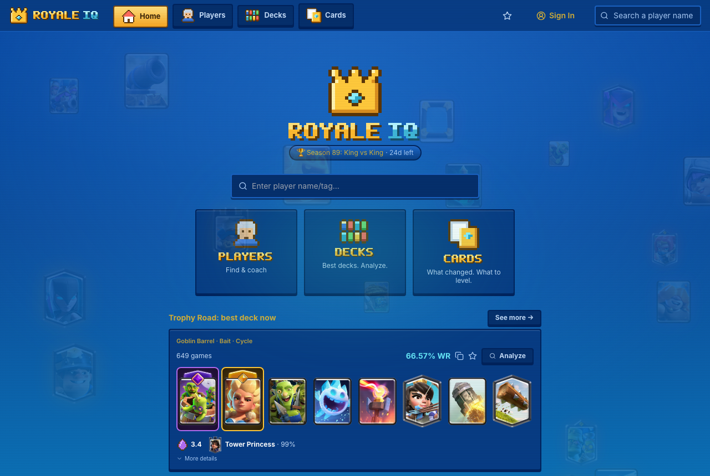
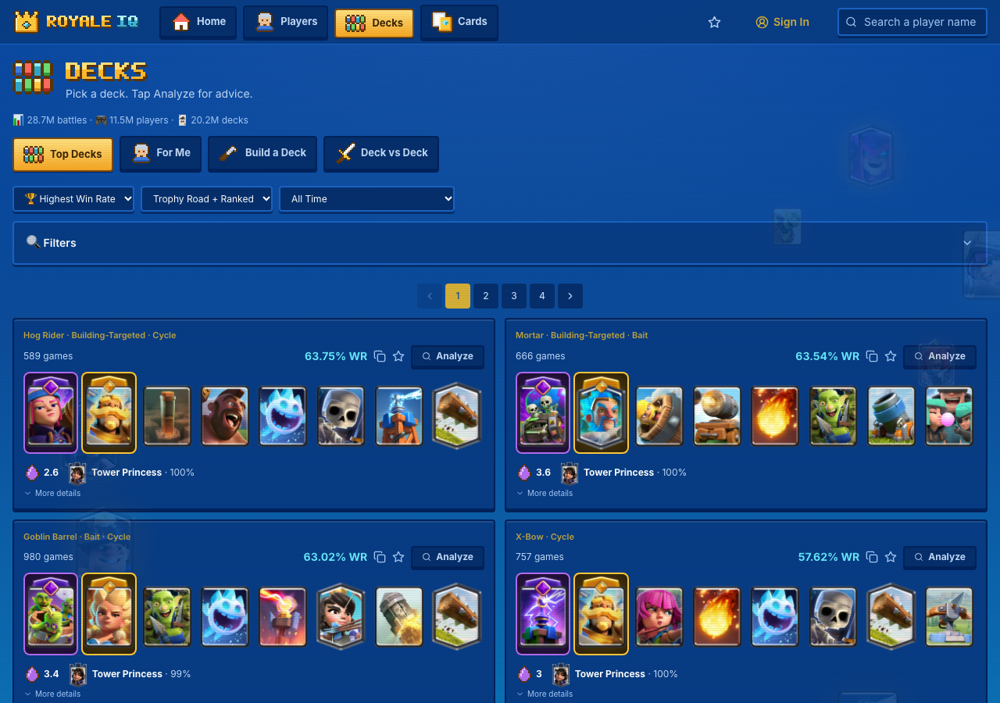
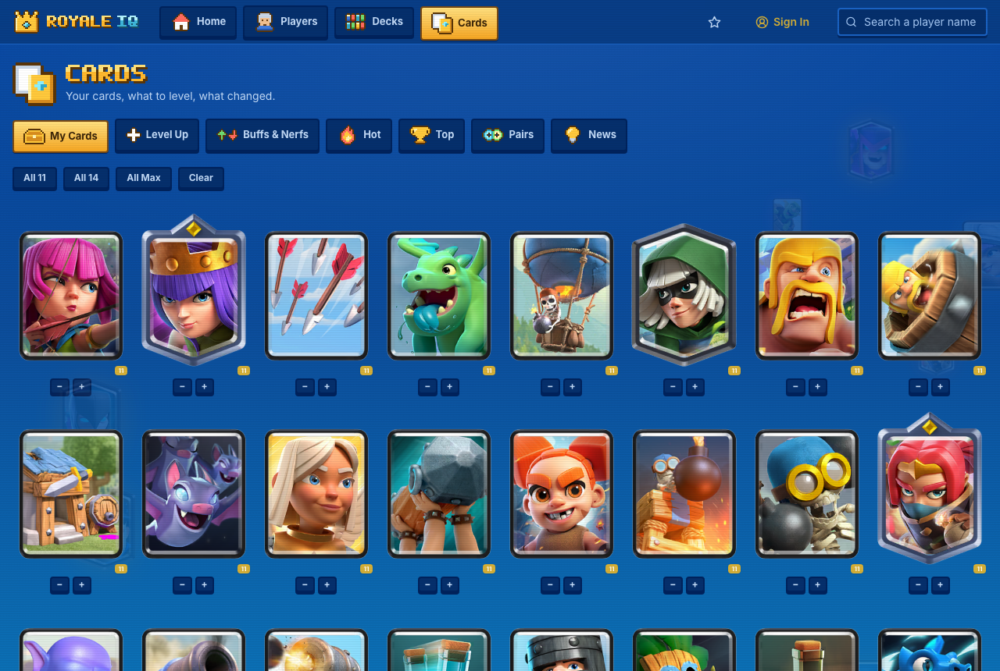
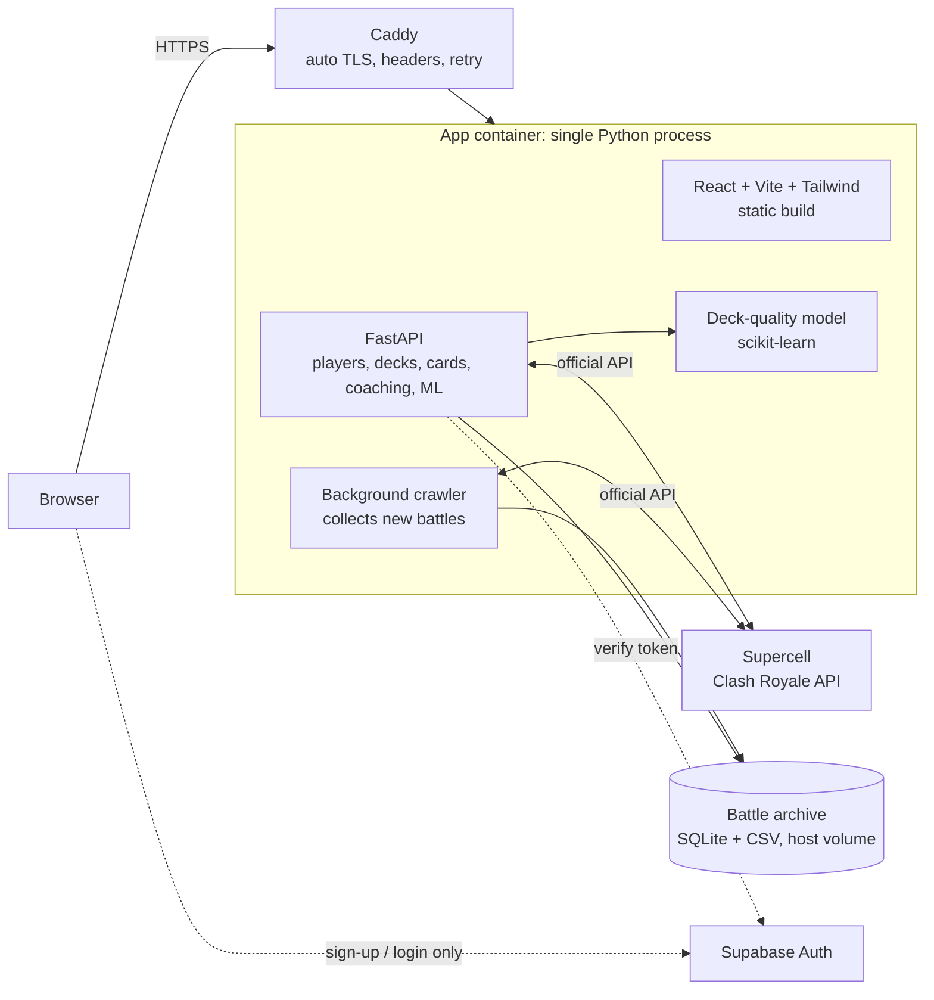

# Royale IQ

**Live site: [royaleiq.com](https://royaleiq.com)**

Royale IQ is a Clash Royale analytics site: look up a player, browse the best decks by real win rate, and see which cards to level or watch. It runs on a continuously growing archive of real battles, about **28.7M battles, 11.5M players and 20.2M decks** at the time of the screenshots below.

This repo is a showcase of the architecture, decisions and engineering rigor behind it. The application source is not published here.

| Home | Decks | Cards |
|---|---|---|
|  |  |  |

## What it does
- **Players:** search by name or tag, see current decks, get personalized coaching tips
- **Decks:** top decks ranked by recorded win rate and game count, deck builder, deck-vs-deck comparison, and a one-tap deck analysis
- **Cards:** your collection and what to level up, balance buffs and nerfs, what is hot, card pairs and news
- **Accounts:** optional sign-in; favorites and collection work without it

## Architecture

Key choices:
- **One container, one origin.** A multi-stage Docker build compiles the React app, then FastAPI serves both the static bundle and the API. No CORS in production and one fixed IP to register with the game API.
- **Caddy in front** for automatic Let's Encrypt certificates, security headers, gzip and a retry window during deploys.
- **Auth is delegated.** Passwords and tokens never touch my backend; Supabase Auth handles them and the API only verifies tokens.
- **Data stays inspectable.** The battle archive is a plain bind-mounted directory, so backups and audits are ordinary file operations.
- **Runs as a non-root user**, with API docs disabled in production.

## The rigor story

**1. Read the data exactly, not by guess.** Cards in the official API carry an `evolutionLevel` that is really a bitmask (1 = Evolution, 2 = Hero, 3 = both). I first treated some cards as "ambiguous", then verified the field against the live API for my own account and found the meaning differs by endpoint: in a player's deck and card list it reflects what is *owned*, while only battle logs carry the *active* form. The fix decodes bits instead of guessing, resolves the equipped form from the newest matching battle, and repairs old archive rows from ownership data where that is provably exact. Rows that cannot be resolved stay labeled ambiguous instead of being guessed.

**2. Never let a model replace evidence.** A deck-quality model estimates win rate from card composition (45 features, trained only on decks with 25+ recorded games, evaluated on a 4,024-deck hold-out with a mean absolute error of about 0.09 in win rate). It is deliberately a fallback: the UI always shows it next to the real recorded win rate and game count, never instead of them, and its caveat ships with the model metadata.

**3. Debug incidents from evidence.** Users hit brief connection errors. Rather than guess, I lined up the proxy's own error log with the deploy history and found the pattern matched same-day deploys: the single-container hard swap left a few seconds where the app refused connections. The proxy now retries through that window.

**4. Measure before building.** Load testing (5-40 concurrent users, about 3,500 requests) produced zero errors and saturated near 38 requests/second on 2 cores, so capacity was not the problem. Usage analysis showed 77% of sessions never left the home page, and that the heaviest pages were the least used. That drove a redesign down to three clear areas (Players, Decks, Cards) with much shorter copy.

**5. Keep secrets out.** API keys live in environment files outside version control, and the full git history was scanned for credentials before anything here was published.

## Stack
Python, FastAPI, scikit-learn, SQLite, React, TypeScript, Vite, Tailwind CSS, Supabase Auth, Docker, Caddy

## Disclaimer
Royale IQ is an unofficial fan-made project and is not affiliated with, endorsed, sponsored, or specifically approved by Supercell. Supercell is not responsible for it. See Supercell's [Fan Content Policy](https://supercell.com/en/fan-content-policy/).
